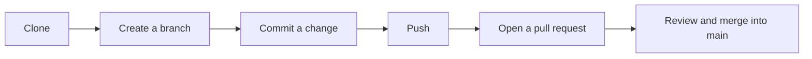

# devops

A practice repository for learning Git and GitHub collaboration: adding a collaborator, working on a branch and merging through a pull request.

## What's here

| File | Purpose |
|---|---|
| `collaborator.txt` | A change made by a collaborator, merged in through pull request #1 from the `Iamagk-new` branch |
| `hi` | A test file from the first commits |

There's no application code. The repo exists to try out the workflow:



## Try it yourself

```bash
git clone https://github.com/Iamagk/devops.git
cd devops
git checkout -b my-change
echo "hello" >> hi
git commit -am "Practice change"
git push -u origin my-change
gh pr create --fill
```
